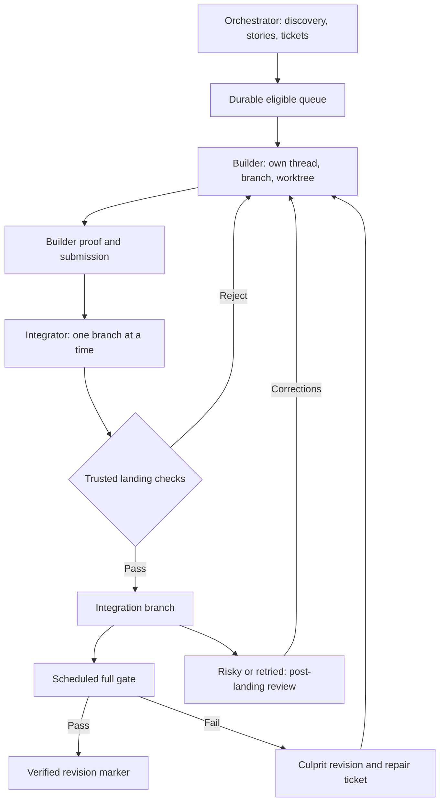

# Software factory

Status: Draft requirements with a locally verified sequential native-worker prototype. The full
unattended factory and cross-orb recovery remain incomplete. Updated 2026-11-13.

## Problem

A long-running implementation thread accumulates unrelated context and needs periodic reminders to
keep finding work. Manually dispatching tickets, passing discoveries between workers, and deciding
whether a stopped agent has actually finished make the operator responsible for the loop.

## Product goal

Turn an application's PRD into a continuing stream of scoped, verified improvements. The operator
sets direction and permissions; the factory discovers work, writes tickets, executes them in
separate threads, and starts the next eligible ticket without reminder threads.

The first proving ground is `mite404/software-factory-test`. The motivating application is
`mite404/design-workshop`, whose own `docs/prd.md` describes the application, not this factory.
Architectural choices belong in [adr.md](adr.md); experiment results belong in
[workflow-trials.md](workflow-trials.md).
Implementation stories and dependencies are tracked in [backlog.md](backlog.md).

## Implementation status

This section summarizes the backlog, not acceptance of every requirement below. Acceptance criteria
describe observable outcomes, not implementation tickets. A ticket may cover several criteria or
only part of one. Evidence and trial limitations remain in [workflow-trials.md](workflow-trials.md).

- F01: Install, repeat-safe setup, check-only mode, and plugin refresh are verified locally.
  Repository service packaging remains incomplete.
- F02: Coordinator, ticket, run, and event persistence uses atomic SQLite transactions. Legacy
  migration is verified. Evidence and lessons still use existing storage.
- F03: Native local-worker dispatch, explicit model and effort, same-worker corrections, supported
  disconnected-state observations, and asynchronous verification are implemented. Automatic executor
  reattachment and cross-orb execution remain unproven. An idle worker is not accepted work.
- F04: Dependency insights exist. Structured phase lessons and relevant retrieval remain planned.
- F05: Private backup implementation is in progress, not accepted. No private repository has been
  provisioned and no production snapshot push is authorized.
- F06: Replacement-orb restore and exclusive orchestrator ownership remain planned.
- F07: A file-backed read-only observation API is verified. Direct SQLite reads and full evidence
  projection remain pending.
- F08: The first dashboard is browser-verified against disposable state and labeled samples.
  SQLite API integration and full evidence views remain pending.
- F09: The dashboard backup control is a disabled placeholder.
- F10: Dashboard steering chat remains planned.
- F11: Safe worker retirement remains planned.
- F12: A versioned project-owned factory definition remains planned. Existing `.factory.json`
  configuration and the documented Foreman prompt are starting points, not the complete system.
- F13: Evidence-based effectiveness, scorecards, and spending reports remain planned.

Automated discovery, scheduled full gates, and the complete backup, restore, and retirement loop
remain outstanding. Implementation workers currently use Sol 6.1 at medium effort, one at a time.
Luna remains available for inexpensive workflow fixtures. The reusable Foreman prompt is documented
in [factory/foreman.md](../factory/foreman.md), not installed automatically as an agent mode.

## Operator needs

- As the operator, I can select bug finding, feature creation, or UI polish without interrupting
  existing ticket execution.
- I can trust each ticket to explain the user problem, intended outcome, evidence, and acceptance
  criteria before a worker starts coding.
- I can leave the factory running without another agent repeatedly prompting it to continue.
- I can inspect progress and blockers through durable tickets, worker links, and concise evidence.
- I can pause work or restrict scope without the factory treating an empty queue as new permission.

## Functional requirements

### R1. Configuration and permission

The factory requires an explicit target repository, PRD, permitted scope, execution capacity, and
action permissions before starting work. Missing configuration produces a visible inactive state.
Permission to discover or implement does not imply permission to file external tickets, push,
merge, deploy, or change production data.

An explicit pause prevents new dispatch and discovery. Existing workers are not silently restarted
or reassigned when configuration changes.

### R2. Discovery modes

The operator selects one discovery mode. When configured discovery is enabled without a selected
mode, bug finding is the default. A mode change applies to the next discovery pass.

| Mode | Required evidence before implementation |
| --- | --- |
| Bug finding | Reproduced failure, expected behavior, affected users, and duplicate check |
| Feature creation | PRD reference or supported opportunity, user story, observable acceptance criteria |
| UI polish | Rendered usability defect, affected state, visual or interaction acceptance criteria |

Discovery is bounded by configured scope and cooldown. An empty queue does not justify duplicate
edge-case tickets or invented work. The factory records an exhausted pass rather than manufacturing
a task. Only one discovery pass can be active for the same configured scope.

### R3. Discovery and ticket ownership

The higher-quality or higher-effort orchestrator owns discovery, product judgment, prioritization,
user stories, and Linear ticket authoring. It may delegate mechanical probes while retaining those
decisions. Worker findings return for assessment rather than automatically expanding ticket scope.

Each ticket identifies the user problem, evidence or PRD reference, scope and exclusions,
dependencies, acceptance criteria, and verification method. Unresolved product decisions remain
blocked. Real ticket creation uses `create-linear-ticket` within granted permissions.

`poteto-mode` and `emil-design-eng` apply where relevant to product discovery and implementation.
Fixture trials do not require production-level code-quality exercises.

### R4. Bug judgment

Before filing a bug, the factory records reproduction evidence, confidence, bug type, user impact,
blast radius, fix scope, duplicate status, priority, and blockers. Blast radius describes who or
what is affected; fix scope describes the required change. Neither substitutes for the other.

Unverified hypotheses remain investigation candidates without a confirmed priority. Duplicates
reference the existing ticket. A blocker or workaround does not automatically reduce severity.
Rating rules must distinguish accessibility defects from cosmetic defects and shared security
failures from local visual issues.

### R5. Ticket execution

One execution thread owns one coherent ticket through implementation, debugging, review, and
verification. Rejected work returns to that thread with actionable evidence. A new ticket receives
a new execution thread. Thread boundaries follow tickets or subsystem changes, not token counts.

Each builder works on its own branch and worktree, leaving the integration checkout untouched.
Only the integrator lands changes, one branch at a time. Failed integration or review returns to
the builder that authored the change rather than a fresh worker.

The first release executes tickets sequentially. The factory respects dependency order and must not
start another worker for a ticket already claimed, running, or awaiting a response.

The factory service and database live in the orchestrator's orb, not in disposable worker orbs.
Retire a worker only after revision-bound verification and integration, preservation of its code and
required evidence outside that orb, and acknowledgment of the private snapshot containing its
accepted outcome and lessons. A link to a file in the worker orb is not preserved evidence.
Missing delivery permission or failed backup blocks retirement, not a reason to publish implicitly.
Pending corrections stay with the same worker. Archival, shutdown, and cleanup are idempotent and
recorded separately from acceptance; a stopped turn alone never triggers retirement.

### R6. Context and shared discoveries

A worker receives its ticket, relevant PRD sections, dependency outcomes, repository and branch
instructions, verification commands, and relevant verified discoveries. It does not receive other
workers' full transcripts or logs.

Discoveries carry scope and evidence references. The orchestrator sends them to dependent future
workers and affected active workers, excluding unrelated work. Hypotheses remain labeled as such.
Full logs stay in durable evidence storage; handoffs contain concise excerpts and links.

After a substantial feature or phase, its execution owner records a concise summary in SQLite.
The summary covers verified findings, bugs encountered, failed approaches, self-corrections, and
unresolved questions. It identifies the repository, phase or ticket, source thread, relevant
revision, affected scope, and evidence. Writing a summary does not mark the work accepted.

The orchestrator retrieves relevant lessons for later tickets instead of copying all past summaries.
Contradicted or outdated lessons remain traceable but are marked superseded. Summary writes are
idempotent per phase and source revision. Credentials and full transcripts are excluded.

### R7. Verification and completion

A worker's final message or stopped turn is not acceptance. The factory requires evidence for the
actual candidate revision against the ticket's criteria before marking it complete. Evidence for
an older revision cannot authorize a changed revision.

Failed verification preserves ticket ownership and returns useful diagnostics. Integration checks
must catch changes that pass independently but fail together. Opening a PR is not inherently
required; repository delivery permissions determine how an accepted change lands.

The target pipeline separates builder proof, serialized landing checks, a scheduled full gate, and
post-landing review of risky or retried changes. A failed full gate records the culprit revision
and creates owned repair work. Landing and full-gate success are distinct facts; a fast-lane landing
must never be labeled fully verified. The native slice initially runs its configured check before
local integration; fast-lane policy, scheduled full gates, and post-landing review are later stages.

### Target workflow

This diagram records the intended boundaries, not a claim that every stage is implemented.
It follows
[Kit Langton's original inspiration](https://x.com/kitlangton/status/2119860603229724930).

### R8. Progress and recovery

Accepted completion triggers the next eligible ticket without a human reminder. Duplicate events,
duplicate wake-ups, and restarts must not duplicate tickets, workers, or landings.

Use Amp's native thread events and supported APIs, not Claude-specific hooks, provider payloads,
or transcript parsing. Normalize observations independently of the selected model or provider.
Reattach subscriptions after restart; polling reconciles missed events and stale connections.
An idle event is an observation, never acceptance evidence by itself.

Recovery reconciles durable state with actual worker state before acting. An idle incomplete worker
resumes only with a concrete next action and no pending message or verification. A human blocker
produces one notification per unchanged blocker; independent eligible work continues.

When no eligible planned work exists, configured discovery may run if capacity and cooldown permit.
Missing configuration never enables fallback discovery. The saved schedule prompt holds recovery
policy; the generic scheduled-wake-up wrapper stays unchanged.

### R9. Status visibility

The operator can distinguish running work, pending verification, blocked work, exhausted discovery,
pause, and missing configuration. Status includes ticket and worker links, dependency outcomes,
blocker ownership, and verified evidence references without requiring transcript inspection.

### R10. Repository setup

Provide a `setup-factory` command or script that prepares an existing Git repository without
requiring factory source edits. It validates prerequisites and records repository-local
configuration for the application PRD, permitted scope, verification commands, discovery mode,
orchestrator and worker models, effort settings, capacity, and action permissions.

Setup must preserve existing application files, PRDs, agent guidance, and user configuration.
Repeated setup preserves existing configuration and runtime state; conflicting settings require an
explicit change rather than a silent reset. Runtime state and logs stay separate from versioned
configuration, and credentials are never written into it.

A check-only mode reports missing prerequisites and configuration without writes or model calls.
Setup leaves execution disabled. Starting workers, enabling schedules, filing external tickets, and
publishing changes require separate explicit authorization. It must not claim the factory is ready
when required runtime components are absent.

### R11. Read-only dashboard data

The dashboard reads structured status from the orchestrator only. The browser needs no direct
filesystem access and no worker connections. Status endpoints read persisted SQLite without invoking
or waking a model. The first view shows the queue, workers, blockers, verification, and timeline.

Use a minimal abstract pipeline inspired by Kit's video. Loop activity motion while a fresh thread
observation says working; precise animation frames need no database event. Names, links, and states
remain accurate. Stop motion on idle, blocked, or stale activity and respect reduced motion.

SQLite is the target store for coordinator state and project memory; endpoints return JSON.
This replaces the earlier JSON-file direction rather than adding a competing source of truth.
Generic mutation routes must not bypass coordinator transitions. State changes persist before
becoming visible as events. Coordinator SQLite persistence and legacy migration are implemented.
The dashboard still reads a file-backed projection; its direct SQLite API remains pending.

### R12. Orb-first operation and persistence

Setup installs into an existing repository in an Amp orb without requiring a separate cloud
deployment for each project. Like Storybook, the factory is another app service in the project:
its source, dependencies, and service configuration live in the repository. Its SQLite runtime data
also lives inside the checkout, separate from versioned configuration. Tracking tool files in Git
does not imply committing the live database. The coordinator, SQLite, and dashboard service run in
the coordinator orb. Workers report through the coordinator; the browser does not connect to worker
orbs.

Expose the dashboard through an authenticated Amp portal. In development, Vite may proxy `/api` to
the coordinator so the browser uses one origin. A built dashboard can share the API server without
a Vite development process. The API exposes permitted fields and evidence, not files or credentials.
Long-lived services use Amp's supervised service mechanism. A portal or dev server does not
guarantee execution while an orb is paused.

Distinguish process restart, orb pause and resume, and orb deletion. SQLite in an orb alone is not a
backup. Keep the live database, journals, and private evidence git-ignored in the application repo,
which may be public. Store consistent snapshots in a separately configured private GitHub repo.
Do not copy a live database file without accounting for its journal. Credentials stay outside
checkpoints. Setup does not create a remote repository or authorize snapshot pushes implicitly.

Restoration checks repository identity and reconciles saved revisions, worker ownership, and pending
remote actions before dispatch. A restored database does not imply that worker worktrees or unpushed
changes survived. Missing or ambiguous evidence blocks redispatch instead of creating replacements.

### R13. Private snapshots and replacement-orb restore

One private state repository may hold snapshots for several projects, isolated by stable project
identity. Only the orchestrator receives state-repository access; workers receive scoped briefs and
lessons, not database copies or backup credentials. Public application history must not contain
private state, snapshot contents, or sensitive evidence.

After accepted work and at phase checkpoints, the orchestrator creates a consistent SQLite snapshot
and pushes it under explicit backup permission, separate from application publishing permission.
Preserve required evidence privately alongside the snapshot or at durable, access-controlled
references. Record the snapshot's project identity, schema version, and source revisions so restore
can validate compatibility. A failed or ambiguous push is not a confirmed backup; inspect remote
state before retrying. Status distinguishes local progress from the last confirmed remote snapshot.

Provide a `factory backup` command and a dashboard **Back up now** button. Both call the same
deterministic backend operation, also used by authorized phase checkpoints, without model calls.
The button uses an authenticated, authorized POST endpoint with cross-origin request protection.
Use the configured project and private destination, never browser-supplied shell commands or Git
credentials. Serialize duplicate requests and show pending, confirmed, or failed status with the
last confirmed snapshot time and commit. A button click does not authorize application publishing.

A replacement orchestrator authenticates, fetches the latest confirmed project snapshot, validates
it, and restores it before dispatch. Authentication failure, invalid data, or a missing expected
snapshot blocks startup rather than silently resetting history. A genuinely new project requires
explicit initialization. Do not overwrite newer local state during an ordinary restart.

Permit one active orchestrator per project. Reject competing snapshot updates and require explicit
ownership recovery before a replacement dispatches; Git rejection alone does not stop two active
loops. Never force-push or merge conflicting SQLite binaries automatically. Work since the last
confirmed snapshot remains at risk if the orchestrator orb is deleted. Git snapshots target small,
phase-level state, not frequent full-log backups; retention and size limits remain to be defined.

### R14. Steering one orchestrator through chat

Provide a dashboard chat that sends steering messages only to the project's configured orchestrator
thread. V1 has no arbitrary thread picker or direct worker messaging. A protected backend endpoint
uses Amp's native thread message API; the browser receives no Amp credentials. Persist request IDs
and delivery outcomes, preserve tested message ordering, and reconcile uncertain appends before
retrying. Show replies and distinguish delivery acknowledgment from model response or completed
work.
Existing action permissions and explicit tool approvals remain in effect. See story F10 for checks.

### R15. Project-owned factory definition

Each installed project owns a versioned, reviewable factory definition in its repository. The shared
engine implements lifecycle and safety rules; project files select supported capabilities and
configure project-specific behavior without requiring an engine fork. The definition covers backend
services and commands, runner requirements, agent roles and instructions, verification gates,
discovery policy, native lifecycle hooks, and supported dashboard capabilities.

Use YAML for human-edited operational declarations, Markdown for agent instructions and notes, and
JSON for schemas, machine-facing contracts, and fixtures. Each setting has one authoritative home,
not equivalent YAML and JSON copies. Reuse existing service declarations where applicable. Keep
SQLite, generated adapters, receipts, and observations separate from the authored definition.
Only public-safe instructions belong in a potentially public application repository; private
lessons, evidence, and credentials retain their existing private storage boundaries.

Validate a schema-versioned definition and its referenced files before execution. Reject unsupported
capabilities, invalid references, and incompatible versions visibly. The backend resolves one
effective configuration; the frontend displays its supported capabilities and permission state
rather than inventing browser-only defaults. Declarative configuration does not replace backend
code, authorization, or a custom frontend when a project genuinely needs one.

Hooks refer to supported native events and explicit local actions with validated inputs, timeouts,
and recorded outcomes. They cannot bypass acceptance, worker ownership, permission checks, or
duplicate-action protection. Merely installing, reading, or refreshing a definition executes no
hook or command. Repository configuration is not permission to access secrets or publish work.

Record the effective definition revision or content digest with each worker run. Changes apply at
an explicit reload boundary for future work; active workers retain their accepted scope and gates.
Workers receive only relevant instructions, not privileged backup configuration or credentials.
Provide a read-only check and effective-configuration view. Preserve operator edits on upgrade and
migrate existing `.factory.json` installations explicitly, without silently changing permissions.
See F12 for acceptance. The configuration engine is not implemented.

### R16. Factory effectiveness and cost visibility

Measure whether the factory delivers verified changes with less repair and intervention, not how
many threads, tokens, tests, or PRs it produces. Extend the existing abstract workbench with an
effectiveness view; the reference screenshots inform capabilities, not the visual design. Show
delivery reliability first, workflow delays next, and scorecards and spending as supporting views.

Correlate project, ticket, worker thread, candidate revision, integration revision, optional PR,
check run and attempt, and evidence. Report opened, merged, closed-unmerged, and pending PRs
separately. Direct-commit projects retain delivery-level reporting without fabricated PR records.
PR merge, local acceptance, remote publication, and post-landing verification are distinct events.

Define the initial measures as follows:

- First-pass CI success: deliveries whose first submitted revision passes all configured required
  checks on their first attempt, divided by deliveries with an observed initial CI outcome.
  Preserve initial failures even after reruns or repairs. Show evidence coverage against all
  eligible deliveries alongside the rate, with numerator and denominator.
- Current CI state: required checks on the exact current revision, with pending, failed, cancelled,
  skipped, stale-revision, unavailable, and no-CI states distinct from passed. No CI is not green.
- Repair after landing: linked regressions, reverts, and repair tickets during a configured
  observation window. Separate confirmed cases, suspected links, mature observations, and changes
  still under observation. Missing incident reporting does not prove defect-free delivery.
- Flow: queue-to-start, start-to-first-proof, verification, review wait, and integration durations,
  plus same-worker corrections and blocked time. Show medians, tails, sample counts, and unfinished
  work age separately. Do not infer active coding time from elapsed thread time.
- Human intervention: explicit rescue or correction requests, separate from planned approvals and
  ordinary steering. Automatic notifications are not human interventions; lower counts alone do
  not prove higher quality.

Each measure states its cohort, time basis, formula, exclusions, freshness, and evidence coverage.
Make underlying deliveries and failure evidence inspectable. Deduplicate events and check attempts;
out-of-order updates cannot erase earlier failures or attach old checks to a changed revision.
Compare matching task categories and configuration versions rather than rank unlike projects.

Keep PR and test-suite scorecards multidimensional. Use deterministic check results for acceptance,
requirement coverage, regression reproduction, and workflow compliance where evidence exists.
Test counts and coverage percentages alone are not test effectiveness. Retain suite versions,
fixture identities, evaluator versions, candidate revisions, counts, and failure evidence. Separate
observed instability from confirmed flaky tests. Optional model judgments are labeled advisory,
versioned with their rubric and model, and never override a failed mandatory gate. Do not collapse
the dimensions into a single factory score or claim a trend across incompatible rubric versions.
Project-specific scorer declarations belong to the factory definition from R15.

Use Amp's [thread usage API](https://ampcode.com/api/external) rather than invent token prices or
scrape its UI. It exposes lifetime thread totals and model, orb, and tool breakdowns. Collect
authorized usage server-side, preserving observation time and source semantics. Count each thread
once, including workers and corrections. Parent usage does not include child-thread usage. Keep
shared orchestration overhead unallocated unless an explicit allocation rule is recorded.

Report Amp-reported USD usage separately from experimental BYOK list-price estimates. These are not
cash invoices or complete provider bills. Do not add included orb/tool/model subtotals to the
thread total again. Missing provider costs, subscription coverage, and inaccessible or expired
records are visible, not free work. Current API retention is 90 days, or 180 days for Enterprise
workspaces; preserve permitted observations before expiry when historical reporting is required.
Time-window spending uses observed usage deltas, not lifetime totals for recently created threads.
Missing boundary observations produce a labeled partial period, not invented historical spend.
Cost per accepted delivery includes attributable retries and shows attribution coverage; retain
failed and abandoned work in project spending rather than hiding it outside successful PRs.

Reports read recorded evidence without model calls or CI reruns. Evaluations are explicit,
permission-controlled work with their own cost. Score changes do not authorize policy changes,
new workers, publications, or self-modification. Implementation and usage ingestion remain planned.

## Acceptance criteria

- AC1: A fixture PRD produces one coherent story and fake ticket with observable acceptance
  criteria.
- AC2: A fresh Luna worker receives the relevant handoff, excluding unrelated transcript content.
- AC3: Accepted ticket A immediately starts eligible ticket B without a reminder or manual dispatch.
- AC4: Rejected work returns to its original worker and can reach verified acceptance there.
- AC5: An insight from A reaches dependent B and an affected active worker, but not unrelated C.
- AC6: False bug reports and duplicate candidates do not create new implementation tickets.
- AC7: Changing discovery mode preserves active work and changes the next discovery pass.
- AC8: Duplicate and concurrent wake-ups, plus restart recovery, create no duplicate side effects.
- AC9: Blocked work notifies once while independent work proceeds; pending messages are respected.
- AC10: Pause, cooldown, missing configuration, and exhausted discovery prevent unauthorized work.
- AC11: Completion claims and stale-revision evidence cannot close a ticket or release dependents.
- AC12: Bug fixtures distinguish severity, blast radius, fix scope, uncertainty, and blockers.
- AC13: The same setup works in two disposable repositories without factory source changes.
- AC14: Repeated setup preserves application files, configuration, and existing ticket state.
- AC15: Check-only setup reports absent prerequisites without writes, model calls, or dispatch.
- AC16: Setup alone starts no workers or schedules, creates no external tickets, and grants no
  publishing permission.
- AC17: Dashboard refreshes read persisted state with no model calls or worker filesystem access.
- AC18: A phase lesson reaches a relevant later worker, excludes unrelated workers, and retains its
  source revision and evidence. Repeated completion events create no duplicate summary.
- AC19: After coordinator restart and orb replacement, restored state preserves lessons and does not
  duplicate uncertain remote actions. Missing worktrees produce an explicit recovery blocker.
- AC20: The dashboard works through an Amp portal with same-origin API requests, without exposing
  SQLite files, secrets, or direct worker access to the browser.
- AC21: A replacement orchestrator restores its project's latest private snapshot before dispatch;
  failed access, wrong project, or incompatible data blocks startup without erasing history.
- AC22: Public application history contains no private database or evidence. Backup permission does
  not grant application publishing permission, and workers have no state-repository access.
- AC23: Competing orchestrators cannot dispatch concurrently for the same project or overwrite each
  other's snapshots. An unconfirmed backup is visible and blocks worker retirement.
- AC24: A verified worker is retired only after its integrated code, required evidence, and accepted
  lessons are preserved outside its orb. Repeated retirement events do not repeat destructive work.
- AC25: CLI, dashboard, and phase backups share one model-free operation. Duplicate clicks do not
  overlap pushes, unauthorized requests fail, and success requires remote confirmation.
- AC26: Two projects customize supported factory behavior through versioned definition files without
  engine source edits. Backend behavior and dashboard capability state use the same configuration.
- AC27: Definition checks reject invalid versions and references without executing commands or
  hooks, starting workers, or granting permissions. Effective configuration exposes no secrets.
- AC28: A recorded definition revision explains a worker's instructions and gates. Reload and
  upgrade preserve active ownership, project edits, and explicit permissions.
- AC29: Duplicate native hook events do not repeat side effects. Failed or unauthorized hooks remain
  visible and cannot bypass revision-bound acceptance or create replacement workers.
- AC30: A failed initial CI run followed by a successful repair remains a first-pass failure.
  Missing checks and stale-revision checks cannot inflate success rates; coverage is visible.
- AC31: Reports distinguish PR merge, accepted direct commits, publication, and post-landing repair,
  with explicit cohorts, unfinished work, observation windows, and inspectable evidence.
- AC32: Versioned PR and suite scorecards preserve counts and failures. An advisory model score or
  high average cannot override a failed mandatory gate or imply unmeasured test effectiveness.
- AC33: Repeated usage imports do not double-count threads or included subtotals. Amp usage, BYOK
  estimates, shared overhead, and missing data stay distinct; partial periods are labeled.
- AC34: Dashboard reads trigger no model calls, evaluations, or CI reruns. Invalid, duplicate, and
  out-of-order events cannot change metric meaning or silently alter execution permissions.

Passing simulations alone does not satisfy native dispatch or restart acceptance. See
[workflow-trials.md](workflow-trials.md) for observed results and limitations.

## Non-goals and rollout constraints

- Replacing application PRDs or making product decisions outside the operator's permitted scope.
- Requiring GitHub PRs or copying another project's direct-to-main delivery permissions.
- Enabling parallel production workers before the sequential lifecycle is verified.
- Creating real Linear tickets, changing the live app, or publishing during disposable trials.
- Treating successful fixture checks as a production reliability or token-savings measurement.

Use GPT-6 Luna for low-token workflow trials. Production model selection is separate from discovery
mode and may differ between orchestrator and worker. Comparative model quality remains unmeasured.

## Open decisions

- Production model and effort selections, and the evidence needed to escalate a worker. Current
  implementation workers use Sol 6.1 at medium effort; this does not settle production policy.
- Recovery cadence and discovery cooldown. Fifteen minutes and one hour respectively are proposals,
  not configured schedules.
- Final bug-rating thresholds beyond the current fixture rubric.
- Runtime distribution and repository service packaging. `factory/setup-factory.ts` implements
  installation, check-only mode, and explicit refresh; complete service packaging remains pending.
- Dashboard endpoint authentication and portal setup. A read-only prototype exists; direct SQLite
  status and full evidence projection remain pending before remote controls.
- Private state-repository configuration and backup verification are in progress. Snapshot retention
  and size limits, orchestrator ownership enforcement, and replacement-orb restoration remain open.
  SQLite persistence and legacy migration are verified, but an orb-local database is not a backup.
- Native dispatch, code transfer, and uncertain-creation recovery across worker orbs. These must
  be proven before connecting the factory to the live application or Linear.
